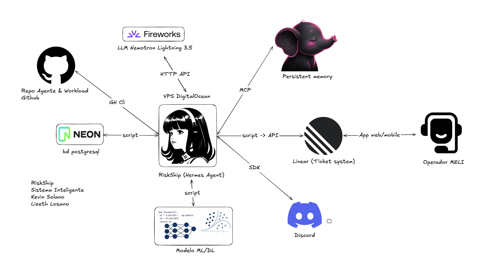

# riskship-rna

Preparación de datos y entrenamiento de una red neuronal artificial (RNA) que
predice la pérdida de envíos. El modelo estima `is_lost` **al crear el envío,
antes del despacho**, de modo que solo usa como variables la información
disponible en ese momento; todo lo registrado después (estado de seguimiento,
causa de la pérdida, monto reembolsado) se trata como fuga de la etiqueta y se
excluye. Está pensado como herramienta de priorización: ordenar los envíos
nuevos para que un equipo revise primero los de mayor riesgo. El repositorio
contiene el pipeline de datos, el notebook de entrenamiento, los scripts de
exportación e inferencia, un segundo enfoque con programación genética (GP) y
los informes que documentan ambos.



## Ruta rápida

1. Crear el entorno: `uv sync`.
2. Generar el dataset desde las exportaciones crudas: `uv run unify_datos.py`.
3. Entrenar y evaluar la RNA: `uv run jupyter lab` y ejecutar
   `notebooks/rna_shipment_loss.ipynb` de arriba abajo (o la ejecución sin
   interfaz descrita en [Uso](#uso)).
4. Exportar el mejor modelo y puntuar envíos: `uv run export_model.py` y
   `uv run predict_risk.py --shipment-id 46411999224`.
5. Compilar los informes:
   `cd informe && Rscript -e 'tinytex::pdflatex("riskship_rna.tex")'` y
   `cd papers && Rscript -e 'tinytex::pdflatex("riskship_gp.tex")'`.

Las cifras que el informe debe citar están en
[Protocolo experimental y resultados (RNA)](#protocolo-experimental-y-resultados-rna);
las reglas que ningún cambio debe romper, en `CLAUDE.md`.

## Estructura del repositorio

| Ruta | Contenido |
|---|---|
| `datos/` | Exportaciones crudas en CSV/JSON (entrada). |
| `unify_datos.py` | Script PEP 723 que unifica `datos/` en `dataset.parquet` (polars, dependencias declaradas en el propio archivo). |
| `dataset.parquet`, `dataset_dictionary.md` | Dataset generado y su diccionario de columnas y tipos. Se versionan, pero nunca se editan a mano. |
| `notebooks/rna_shipment_loss.ipynb` | Exploración, limpieza, entrenamiento y evaluación del modelo de pérdida (RNA). |
| `notebooks/gp_shipment_loss.ipynb` | Notebook autocontenido del enfoque de programación genética. |
| `AutogluonModels/` | Artefactos de los modelos entrenados (generados, excluidos del control de versiones). |
| `export_model.py` | Exporta el mejor predictor por semilla como un único pickle autocontenido en `exports/`. |
| `predict_risk.py` | Puntúa envíos (JSON o filas del dataset) con el pickle exportado y marca los que superan el umbral de riesgo. |
| `load_neon.py`, `sql/shipments.sql` | Crean la tabla `shipments` en Neon (espejo de `dataset.parquet`) y la cargan en bloque; el perfil `riskship` del agente Hermes la lee desde un cron. |
| `gp_full_experiment.py`, `tests/` | Experimento GP completo y sus pruebas (ver [Programación genética (GP)](#programación-genética-gp)). |
| `docs/images/` | Diagrama de arquitectura incluido en este README. |
| `docs/GP_ENTRENAMIENTO_COMPLETO.md`, `docs/GP_EXPERIMENTOS.md` | Metodología, resultados y límites del enfoque GP. |
| `results/gp_full_v1/` | Métricas agregadas por semilla del experimento GP. |
| `informe/` | Informe del proyecto en formato IEEE (`riskship_rna.tex`, LaTeX, en español) y `figuras/`, exportadas por el notebook. |
| `papers/` | Artículo del enfoque GP (`riskship_gp.tex`, `riskship_gp.pdf`) y `figuras/`. |

## Requisitos y entorno

```bash
uv sync
```

Python está fijado en 3.12 (`.python-version`, `requires-python = ">=3.12,<3.14"`
en `pyproject.toml`). Es una restricción dura de `autogluon-tabular` 1.6.3, que
exige Python `<3.14` y `pandas<2.4`; no se debe subir ninguna de las dos
versiones sin comprobar antes los rangos que AutoGluon admite.

## Uso

### Generar el dataset

Reconstruir el dataset a partir de las exportaciones crudas:

```bash
uv run unify_datos.py
```

### Ejecutar el notebook

Abrirlo de forma interactiva:

```bash
uv run jupyter lab
```

Ejecutarlo sin interfaz (para CI o una prueba rápida de humo):

```bash
RNA_TIME_LIMIT=90 RNA_N_SEEDS=2 RNA_FIGURES_DIR=<output-dir>/figuras uv run jupyter nbconvert --to notebook --execute \
  notebooks/rna_shipment_loss.ipynb --output-dir <output-dir> \
  --output executed.ipynb --ExecutePreprocessor.timeout=1800
```

| Variable | Efecto |
|---|---|
| `RNA_TIME_LIMIT` | Segundos (600 por defecto) que limitan el entrenamiento de AutoGluon **por semilla**. |
| `RNA_N_SEEDS` | Número de semillas a entrenar (5 por defecto). |
| `RNA_FIGURES_DIR` | Directorio al que se exporta cada figura a 300 dpi (`informe/figuras/` por defecto, que es lo que incluye el informe). |

Para una prueba de humo, mantener `RNA_TIME_LIMIT` y `RNA_N_SEEDS` bajos y
apuntar `RNA_FIGURES_DIR` a otro directorio; de lo contrario sobrescribe las
figuras del informe.

El notebook se versiona ejecutado, de modo que sus figuras y métricas se leen
directamente en GitHub. Esos resultados provienen de una ejecución completa con
el límite de tiempo y el número de semillas por defecto.

### Exportar el modelo

Exportar el mejor modelo entrenado como un único pickle autocontenido:

```bash
uv run export_model.py                     # -> exports/riskship_rna_model.pickle (+ .json)
uv run export_model.py --seed 46 --out model.pickle
```

El script lee los predictores por semilla que el notebook dejó en
`AutogluonModels/`, elige la semilla con mejor PR-AUC en **validación** (la
misma regla que el notebook usa para su modelo de referencia), carga todas las
redes en memoria y serializa el predictor completo, de modo que el archivo
predice sin el directorio del modelo. Después recarga el pickle en un
intérprete nuevo con ese directorio oculto y exige puntuaciones idénticas. El
`.json` adjunto registra la semilla, la lista de variables y las versiones de
las librerías: deserializar requiere las mismas versiones de
`autogluon.tabular`, `torch`, `fastai` y `pandas`. Usar
`export_model.prepare_features` para derivar `day_of_week` y rellenar
`TIPO_BULKY` a partir de una exportación cruda antes de llamar a
`predict_proba`.

### Puntuar envíos

Puntuar envíos con el modelo exportado desde la línea de comandos (el perfil
`riskship` del agente Hermes lleva su propia copia del pickle y de este script
en su skill `riesgo-envio`; copiar `exports/` allí después de reexportar):

```bash
uv run predict_risk.py shipment.json              # JSON object or list of objects
uv run predict_risk.py --shipment-id 46411999224  # a row from dataset.parquet
uv run predict_risk.py --sample 3 --threshold 0.65
```

Imprime un único documento JSON con la probabilidad de pérdida por envío y una
marca `at_risk` respecto al umbral (0,65 por defecto). La probabilidad está en
la escala de la muestra caso-control, no de la prevalencia de producción (ver
[Cómo leer estos números](#cómo-leer-estos-números)).

### Cargar el dataset en Neon

Replicar el dataset en Neon para el cron horario del agente Hermes
(`riesgo-envio-neon`):

```bash
NEON_DATABASE_URL='postgresql://...' uv run load_neon.py   # role with write access
```

`sql/shipments.sql` tiene las mismas 58 columnas del parquet (entre comillas,
con mayúsculas y minúsculas preservadas) más `id` (la marca de agua del cron) y
`created_at`. `load_neon.py` es un script PEP 723 (`pyarrow`, `psycopg`), por
lo que `uv run` lo resuelve fuera del entorno del proyecto. Regenerar el DDL si
cambian las columnas del dataset.

## Datos

`dataset.parquet` contiene 262.317 filas x 58 columnas, una fila por
**artículo** del envío (no por envío: un envío con varios artículos ocupa
varias filas; ver `dataset_dictionary.md` para la lista completa de columnas).
La etiqueta es `is_lost` (Int, 0/1), con cerca de un 24 % de positivos antes de
la limpieza. Tras los pasos de limpieza del notebook (eliminación de filas con
artefactos de valores faltantes y restricción a los meses en que se observan
ambas clases y la etiqueta ha madurado), el dataset utilizable es menor y se
acerca a una proporción 37/63; los números exactos están en el notebook,
calculados a partir de los datos y no fijados aquí.

## Decisiones de modelado clave

| Decisión | Motivo |
|---|---|
| Momento de predicción: al crear el envío, antes del despacho | Solo las columnas conocidas en ese momento pueden ser variables; se eliminan las columnas de seguimiento, estado y causa de pérdida posteriores a la creación. |
| Columnas con fuga eliminadas (`CAUSA_BPP`, `CLASSIFICATION_LM`, `F_CLASIFICATION*`, `BPP_CASHOUT_USD`, `status_*`/`date_status_1..10`, ...) | No nulas en ~100 % de las filas perdidas y 0 % de las no perdidas, o línea de tiempo posterior al despacho: reformulaciones puras de la etiqueta. |
| `LG_REGION` eliminada | La misma instalación se exporta con distintos nombres de región según la clase de la fila, así que la columna codifica la etiqueta mediante una taxonomía inconsistente; `SHP_LG_FACILITY_ID` aporta la señal geográfica sin ese riesgo. |
| Ventana temporal restringida a los meses con ambas clases y etiqueta madura | Los meses recientes tienen cero etiquetas de pérdida porque la etiqueta aún no ha madurado (artefacto de extracción), no porque el riesgo haya caído a cero. Un mes final puede tener unos pocos positivos y seguir inmaduro (2026-04: ~1 % perdidos frente a 31-47 % antes), así que también se eliminan los meses finales por debajo de `MATURITY_RATIO` x la mediana de la tasa mensual de pérdida. |
| Sin variables de fecha absoluta, solo día de la semana | Usar año o mes permitiría al modelo reaprender el artefacto de muestreo anterior. |
| Filas con nulos en los numéricos centrales o en `date_status_0` eliminadas | Esos nulos son ~100 % perdidos: un artefacto de cómo se extrajeron las dos clases, no una relación real. |
| Partición temporal por mes de `date_status_0` (los meses más antiguos entrenan, los más recientes validan y prueban) | Ninguna información futura llega al entrenamiento, y el test responde la pregunta operativa: qué tan bien ordena el modelo envíos que aún no existían. Los meses se eligen a partir de los datos (`MIN_HOLDOUT_SHARE`). Un envío puede ocupar varias filas de artículo, por lo que el notebook verifica que ningún `SHIPMENT_ID` cruce particiones. |
| Varias semillas, partición fija | El entrenamiento se repite con `N_SEEDS` semillas sobre la misma partición y el mismo test, por lo que las métricas se reportan como media y desviación estándar y no como una única ejecución. |
| Métricas de ranking (`recall_en_K`, `precision_en_K`) junto a PR-AUC / ROC-AUC | El modelo es una herramienta de priorización: lo que importa es cuántas pérdidas reales caen dentro de la fracción de envíos que un equipo puede revisar. |
| AutoGluon restringido a `NN_TORCH` + `FASTAI` | El objetivo es específicamente una red neuronal, no el ensamble de árboles por defecto de AutoGluon. |
| `eval_metric="average_precision"` | La etiqueta está desbalanceada (~24 % positivos en crudo, cerca de un tercio tras la limpieza); la exactitud es engañosamente alta para un modelo que solo predice la clase mayoritaria. |

## Protocolo experimental y resultados (RNA)

Estas son las cifras que el informe del proyecto debe citar. Provienen de la
ejecución versionada del notebook (`RNA_TIME_LIMIT=600`, `RNA_N_SEEDS=5` por
defecto) y se calculan sobre el mes de test reservado. Si el notebook se vuelve
a ejecutar y cambia algún número, actualizar esta sección y `CLAUDE.md` en el
mismo commit.

### Protocolo

| Elemento | Valor |
|---|---|
| Modelo | AutoGluon `TabularPredictor`, solo redes neuronales: `NN_TORCH` (MLP en PyTorch) + `FASTAI`, combinadas por un ensamble ponderado; hiperparámetros por defecto |
| Métrica optimizada | `average_precision` (PR-AUC) |
| Dataset limpio | 165.002 filas (artículos), de 2025-09 a 2026-03, ~37 % positivos |
| Partición | Temporal, por mes de `date_status_0`; meses elegidos a partir de los datos (`MIN_HOLDOUT_SHARE = 0.10`) |
| Semillas | 5 semillas: 42, 43, 44, 45, 46 (`RANDOM_STATE = 42`, consecutivas) |
| Qué cambia una semilla | Solo el entrenamiento de las redes (inicialización de pesos, orden de lotes, dropout): `seed_value` para `NN_TORCH`, `random_seed` para `FASTAI`. La partición y el test son idénticos entre semillas |
| Dispersión | Desviación estándar muestral entre las 5 semillas (`ddof = 1`) |
| Umbral de clasificación | 0,5 sobre la probabilidad predicha; clase positiva = perdido |
| Modelo de referencia | Semilla 46, elegida por mejor PR-AUC en **validación** (0,7671), nunca por la puntuación de test |
| Costo de entrenamiento | ~100 s por semilla (78-128 s); es tiempo de reloj, así que varía entre ejecuciones mientras todas las métricas siguientes se reproducen exactamente. La parada temprana termina mucho antes del tope de 600 s |

| Partición | Meses | Filas | Proporción | Envíos | Tasa de positivos |
|---|---|---|---|---|---|
| Entrenamiento | 2025-09 a 2026-01 | 125.082 | 75,8 % | 112.303 | 39,0 % |
| Validación | 2026-02 | 18.831 | 11,4 % | 17.297 | 31,6 % |
| Test | 2026-03 | 21.089 | 12,8 % | 19.506 | 31,2 % |

### Métricas de test en las 5 semillas

| Métrica | Media | DE |
|---|---|---|
| PR-AUC (average precision) | 0,7496 | 0,0020 |
| ROC-AUC | 0,8241 | 0,0020 |
| Recall (perdido, umbral 0,5) | 0,5339 | 0,0136 |
| Precisión (perdido, umbral 0,5) | 0,7568 | 0,0157 |
| F1 (perdido, umbral 0,5) | 0,6259 | 0,0044 |
| Tasa de falsos positivos (umbral 0,5) | 0,0781 | 0,0089 |
| PR-AUC en validación | 0,7644 | 0,0019 |

La línea base de PR-AUC es la tasa de positivos del test, 0,312 (un modelo que
ordena al azar). La dispersión entre semillas es pequeña, por lo que el
resultado no depende de la semilla.

### Métricas de ranking (priorización)

`recall_en_K` es la fracción de todas las pérdidas reales que se encuentran en
el K % superior de las filas de test ordenadas por puntuación; `precision_en_K`
es la fracción de ese K % superior que realmente se perdió. Media y DE en las 5
semillas:

| Fracción revisada (K) | Filas revisadas | Recall@K | Precision@K | Recall@K máximo posible |
|---|---|---|---|---|
| 1 % | 211 | 0,0321 (DE 0,0000) | 1,0000 (DE 0,0000) | 0,032 |
| 5 % | 1.054 | 0,1581 (DE 0,0006) | 0,9873 (DE 0,0038) | 0,160 |
| 10 % | 2.109 | 0,3019 (DE 0,0020) | 0,9421 (DE 0,0061) | 0,320 |
| 20 % | 4.218 | 0,5060 (DE 0,0024) | 0,7895 (DE 0,0037) | 0,641 |

Revisar el 20 % superior captura cerca del 51 % de las pérdidas, 2,5 veces
mejor que revisar al azar. Recall@K está acotado por la prevalencia: con 31,2 %
de positivos, ni siquiera un ranking perfecto puede capturar más de K / 0,312
de las pérdidas.

Modelo de referencia (semilla 46), matriz de confusión en test con umbral 0,5:

| | Predicho no perdido | Predicho perdido |
|---|---|---|
| Realmente no perdido | 13.425 | 1.082 |
| Realmente perdido | 3.094 | 3.488 |

### Proyección a la prevalencia real

Modelo de referencia (semilla 46), proyectado con `REAL_PREVALENCE = 0.001`
(la estimación del equipo sobre la tasa real de pérdida, no medida en este
dataset). Para cualquier umbral de puntuación: fracción revisada = pi x recall
+ (1 - pi) x FPR, y precisión real = pi x recall / fracción revisada.

| Puntuación mínima | Recall | Tasa de falsos positivos | Envíos revisados | Revisados por pérdida real | Mejora sobre el azar |
|---|---|---|---|---|---|
| 0,91 | 0,159 | 0,0008 | 0,09 % | 6 | 173x |
| 0,78 | 0,299 | 0,0097 | 1,00 % | 33 | 30x |
| 0,53 | 0,507 | 0,0606 | 6,10 % | 120 | 8,3x |
| 0,50 | 0,530 | 0,0746 | 7,50 % | 142 | 7,1x |

Titular para el informe: revisar el 1 % superior de los envíos reales
capturaría cerca del 30 % de las pérdidas, una pérdida real por cada 33 envíos
revisados. La proyección supone que los negativos muestreados representan a
los reales, algo que los artefactos de extracción ponen en duda, y las filas con
una tasa de falsos positivos cercana a cero son las más expuestas al artefacto
sospechado en `DOM_DOMAIN_ID`. Es una proyección, no una medición.

### Cómo leer estos números

- **La muestra es caso-control, a propósito.** La pérdida real ronda el 0,1 %,
  así que la exportación conserva las pérdidas y solo una fracción de los
  envíos sanos (~31-39 % positivos aquí). Ese diseño es válido. Bajo él, solo
  el recall y la tasa de falsos positivos se trasladan a producción sin cambios
  (cada uno se calcula dentro de una sola clase), por lo que ROC-AUC es válido
  tal cual. Precisión, PR-AUC, Precision@K, Recall@K y la mejora sobre el azar
  dependen de la prevalencia: describen la calidad del ranking **dentro de esta
  muestra** y ninguna es una cifra de producción (el techo de la mejora es
  1/prevalencia: ~3 aquí, ~1000 en producción). Ver
  [Proyección a la prevalencia real](#proyección-a-la-prevalencia-real).
- **Los artefactos provienen de extraer las dos clases de forma distinta**, no
  de la proporción de clases: los nombres de `LG_REGION`, los nulos que revelan
  la clase, `DATEPARAMETER` y probablemente `DOM_DOMAIN_ID`.
- **Precision@1 % = 1,000 es sospechoso, no un triunfo.** Seis valores de
  `DOM_DOMAIN_ID` son 100 % perdidos con 200-834 filas cada uno (p. ej.
  `CELLPHONE_CASES_AND_COVERS`), lo que parece el mismo artefacto de taxonomía
  ligada a la clase encontrado en `LG_REGION`. Es un asunto abierto y
  probablemente infla la parte más alta del ranking.
- **No comparable con la ejecución anterior.** Una versión previa usó una
  partición aleatoria por grupos y conservó el mes inmaduro 2026-04; obtuvo
  ROC-AUC 0,848 / PR-AUC 0,800. La caída a 0,824 / 0,750 es el costo de un test
  temporal honesto, no una regresión.
- **Nivel de artículo.** Las filas son artículos de envío, así que todas las
  métricas son por artículo, no por envío.
- **Un solo mes de test.** El test es un único mes; mide la generalización al
  mes siguiente, no entre temporadas.

## Programación genética (GP)

El segundo enfoque de RiskShip evoluciona árboles simbólicos con DEAP para
predecir `is_lost` por artículo con las mismas variables fuente y la misma
partición temporal de la RNA. El fitness usa las 125.082 filas de train.
Se compararon tres configuraciones y se completaron cinco semillas para la
configuración seleccionada por validación, más cinco corridas sin dominio.

| Métrica test (media ± DE, cinco semillas) | GP | GP sin DOM_DOMAIN_ID | RNA reportada |
|---|---:|---:|---:|
| PR-AUC | 0,6393 ± 0,0338 | 0,5767 ± 0,0160 | 0,7496 ± 0,0020 |
| ROC-AUC | 0,7734 ± 0,0186 | 0,7517 ± 0,0163 | 0,8241 ± 0,0020 |
| Recall@20 % | 0,4450 ± 0,0199 | 0,3994 ± 0,0104 | 0,5060 ± 0,0024 |

La RNA conserva su implementación y resultados originales. Las cifras GP son
medidas en este experimento; no alcanzan las de RNA y se observó dependencia
de la variable de dominio. No son métricas de producción.

```bash
uv sync --frozen
uv run python -m unittest discover -s tests -v
uv run python gp_full_experiment.py --workers 2
```

El entrenamiento ampliado usa validation para seleccionar configuración,
árbol y umbral; la selección queda registrada antes de evaluar test. El test
es el mismo holdout previamente conocido del RNA. Los modelos GP con mapas
de categorías se conservan localmente y se excluyen del control de versiones.

| Recurso | Enlace |
|---|---|
| Instrucciones GP | [README_GP.md](README_GP.md) |
| Notebook GP autocontenido, ejecutado localmente | [notebooks/gp_shipment_loss.ipynb](notebooks/gp_shipment_loss.ipynb) |
| Metodología, resultados y limitaciones | [docs/GP_ENTRENAMIENTO_COMPLETO.md](docs/GP_ENTRENAMIENTO_COMPLETO.md) |
| Resultados por semilla | [results/gp_full_v1/final_metrics.csv](results/gp_full_v1/final_metrics.csv) |
| Comparación gráfica RNA vs. GP | [papers/figuras/rna_gp_comparison.png](papers/figuras/rna_gp_comparison.png) |
| Artículo GP | [papers/riskship_gp.tex](papers/riskship_gp.tex) / [papers/riskship_gp.pdf](papers/riskship_gp.pdf) |

Enlaces pendientes: la carpeta `results/gp_full_v1/figures/` que menciona
`README_GP.md` no está en el repositorio; la figura de comparación se enlaza
desde `papers/figuras/`.

## Cómo reextraer los datos

El problema no es la proporción de clases, sino extraer las dos clases por
caminos distintos. Una exportación futura debe:

1. Usar **una sola consulta para ambas clases**: misma población, filtros,
   tablas de origen y ventana de fecha de creación. Calcular la etiqueta
   después sobre ese único conjunto.
2. **Submuestrear solo los negativos, al azar y a una tasa registrada** `r`
   (conservar todas las pérdidas de la ventana). Sin `r`, las probabilidades
   predichas no pueden corregirse a la escala real (odds reales = odds
   predichos x `r`).
3. Incluir solo envíos cuya **etiqueta haya madurado**: creados hace más de N
   días, siendo N el tiempo en que ~99 % de las pérdidas ya se han declarado.
   Aplicarlo a ambas clases.
4. Tomar los atributos **tal como eran al crear el envío**, no su valor actual.
5. Muestrear **por envío**, no por artículo.

Ver `CLAUDE.md` para la lista completa de restricciones que un cambio futuro no
debe romper.

## Informes y artículos

| Documento | Fuente | Compilar |
|---|---|---|
| Informe del proyecto (RNA), formato IEEE, en español | `informe/riskship_rna.tex` (figuras en `informe/figuras/`, exportadas por el notebook) | `cd informe && Rscript -e 'tinytex::pdflatex("riskship_rna.tex")'` |
| Artículo del enfoque GP | `papers/riskship_gp.tex` / `papers/riskship_gp.pdf` (figuras en `papers/figuras/`) | `cd papers && Rscript -e 'tinytex::pdflatex("riskship_gp.tex")'` |

Las figuras del informe las genera el notebook; no se editan a mano. Todo
número citado en los informes proviene de la ejecución versionada del
notebook, así que la regla del mismo commit de
[Protocolo experimental y resultados (RNA)](#protocolo-experimental-y-resultados-rna)
también los cubre.

## Referencias internas

| Archivo | Para qué |
|---|---|
| [CLAUDE.md](CLAUDE.md) | Restricciones de modelado, comandos y reglas que ningún cambio debe romper. |
| [README_GP.md](README_GP.md) | Instrucciones de entrenamiento, uso del árbol entrenado e interpretación del enfoque GP. |
| [docs/GP_ENTRENAMIENTO_COMPLETO.md](docs/GP_ENTRENAMIENTO_COMPLETO.md) | Metodología, resultados y limitaciones del experimento GP completo. |
| [docs/GP_EXPERIMENTOS.md](docs/GP_EXPERIMENTOS.md) | Registro de la ejecución inicial de humo del enfoque GP. |
| [dataset_dictionary.md](dataset_dictionary.md) | Diccionario de columnas y tipos del dataset generado. |
